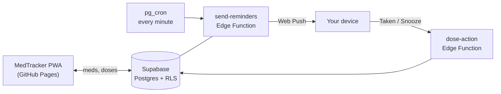
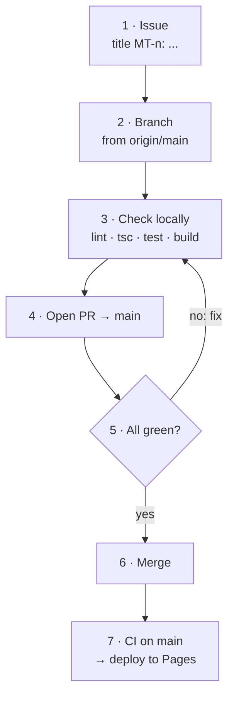

<div align="center">

# MedTracker

**Medication reminders that reach your phone, even when the app is closed.**

[](https://github.com/danhquach/medtracker/actions/workflows/ci.yml)
[](https://danhquach.github.io/medtracker/)

### [Open the app →](https://danhquach.github.io/medtracker/)

No install needed · start as a guest or sign in

[Install](#install-for-reminders) · [How it works](#how-it-works) · [Develop](#develop) · [Workflow](#workflow) · [Operations](docs/OPERATIONS.md)

</div>

---

## Install for reminders

Reminders need the app on your home screen.

| Android (Chrome) | iPhone / iPad (Safari, iOS 16.4+) |
|---|---|
| 1. Menu → **Install app** | 1. Share → **Add to Home Screen** |
| 2. Allow notifications | 2. Open the installed app |
| Late reminders? Set Chrome's battery use to **Unrestricted** | 3. Turn on push from inside it |

**Android app (sideloaded):** same app, but reminders are scheduled on the phone (exact time, offline, own chime). Needs Android Studio's SDK and JDK 21.

The app loads the live site, so a web change merged to `main` shows up the next time the app is opened or brought back to the front (online). It opens offline once it has been opened online. Rebuild the APK only for native changes: a plugin, permission, notification sound, icon or app name.

```sh
npm run android:apk        # live site (production data)
npm run android:apk:mock   # bundled, in-browser fake backend: offline device testing
adb install -r android/app/build/outputs/apk/debug/app-debug.apk
```

Both builds share one app ID, so only one is installed at a time. Moving from an older bundled APK to the live one: open the old app online first so pending changes sync, install over it (`adb install -r`, never uninstall), sign in again and turn notifications back on. The old reminders are cleared on first start, so nothing rings twice.

Then turn on notifications in the app. Use the Android app *or* the installed web app on a phone, not both, or each dose rings twice. The phone plans a week ahead and updates when the app opens: open it at least weekly, and note a dose marked on another device still rings on the phone until then.

## How it works



**Stack:** Vite · React · TypeScript · Supabase (Postgres, RLS, `pg_cron`, Vault, Edge Functions) · Web Push (VAPID)

## Develop

> [!WARNING]
> The only Supabase project is **production** ([#10](https://github.com/danhquach/medtracker/issues/10)). `npm run dev` with `.env.local` reads and writes real data.

**1. Install**

```sh
npm install
```

**2. Add env files** (gitignored — never commit real values)

| File | Copy from |
|---|---|
| `.env.local` | `.env.example` |
| `supabase/functions/.env` | `supabase/functions/.env.example` |
| `.env.test` | [variable list](docs/OPERATIONS.md#environment-files) |

**3. Run**

```sh
npm run dev
```

### Tests

| Command | Runs | Needs |
|---|---|---|
| `npm test` | Unit | nothing |
| `npm run test:int` | Integration | test project + `SUPABASE_ENV=test` |
| `npm run test:e2e` | Playwright (Chromium) | test project + `SUPABASE_ENV=test` |

> [!CAUTION]
> Integration/e2e tests create and delete users. Never set `SUPABASE_ENV=test` or run `supabase db reset --linked` while the linked project is production.

## Workflow



| Step | Detail |
|---|---|
| **3 · Check locally** | `npm run lint` · `npx tsc --noEmit -p tests` · `npm test` · `npm run build`<br/>Touching Supabase or user flows? Also `test:int` / `test:e2e` (CI can't — needs secrets). |
| **5 · All green** | CI passes **and** review findings resolved **and** issue acceptance criteria met.<br/>GitHub enforces only CI + resolved threads; the rest is on whoever merges. |
| **6 · Merge** | Squash or merge commit. Auto-merge is fine. Never push or `git merge` to `main` directly. |

## More

| Doc | For |
|---|---|
| [Operations](docs/OPERATIONS.md) | CI and branch rules, deploying Supabase + Pages, reminder troubleshooting, known risks, device checklist |
| [Issues](https://github.com/danhquach/medtracker/issues) | Bugs and work, titled `MT-<n>: ...` |
