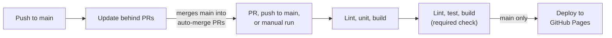
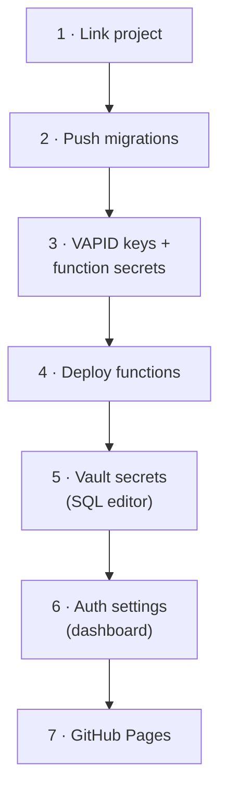

# MedTracker operations

Owner/maintainer reference. New here? Start with the [README](../README.md).

| Section | Use it when |
|---|---|
| [Environment files](#environment-files) | Setting up `.env*` |
| [CI and branch rules](#ci-and-branch-rules) | A PR check fails or won't merge |
| [Deploy](#deploy) | Setting up Supabase or GitHub Pages |
| [Troubleshooting reminders](#troubleshooting-reminders) | Pushes don't arrive |
| [Daylight saving](#daylight-saving) | A dose time looks shifted around a clock change |
| [Known risks](#known-risks) | Planning or debugging odd delays |
| [Manual device checklist](#manual-device-checklist) | Testing on real phones |

**Backend at a glance:** Edge Functions `send-reminders`, `dose-action`, `delete-account` · migrations `0001`–`0007` in `supabase/migrations` · auth: anonymous sign-ins **ON** (guest mode), email confirmation **ON**.

---

## Environment files

All gitignored. Never commit real values.

| File | Variables | Template |
|---|---|---|
| `.env.local` | `VITE_SUPABASE_URL` (`https://<project-ref>.supabase.co`), `VITE_SUPABASE_ANON_KEY` (publishable key), `VITE_VAPID_PUBLIC_KEY` | `.env.example` |
| `.env.test` | `SUPABASE_ENV` (`test` only for a dedicated test project), `SUPABASE_URL`, `SUPABASE_PUBLISHABLE_KEY`, `SUPABASE_SECRET_KEY`, `SUPABASE_DB_PASSWORD` (quote it), `ACTION_TOKEN_KEY`, `CRON_SECRET` | none; see names here |
| `supabase/functions/.env` | `VAPID_PUBLIC_KEY`, `VAPID_PRIVATE_KEY`, `VAPID_SUBJECT`, `CRON_SECRET`, `ACTION_TOKEN_KEY` | `supabase/functions/.env.example` |

> [!CAUTION]
> Integration and e2e tests create and delete users. They refuse to run unless `.env.test` sets `SUPABASE_ENV=test` — set that only when `.env.test` points at a dedicated test project.
>
> `npx supabase db reset --linked --yes` **wipes the linked project**, which is production. Don't run it until a separate test project exists.

---

## CI and branch rules



| Job / workflow | What it does |
|---|---|
| **Lint, unit, build** | `npm ci` → lint → type-check `src` + `tests` → unit tests → build. On `main`, builds for Pages (`build:pages`, base `/medtracker/`) and uploads the artifact. |
| **Lint, test, build** | The required status check; passes only when the build job succeeded. |
| **Deploy to GitHub Pages** | `main` only, after the check passes. |
| **Update behind PRs** (`update-behind-prs.yml`) | On each push to `main`, merges `main` into every open PR with auto-merge on, so CI reruns and auto-merge can finish. PRs without auto-merge: click **Update branch**. |

Workflow file: `.github/workflows/ci.yml` ([runs](https://github.com/danhquach/medtracker/actions/workflows/ci.yml)). The repo is public, so Actions minutes are free. CI does not run integration/e2e tests (they need secrets).

> [!NOTE]
> PRs build with base `/`, so a bug that only shows under `/medtracker/` (asset paths, router, service worker scope) first appears on the live site after merge.

> [!IMPORTANT]
> "Update behind PRs" needs repo secret `AUTO_UPDATE_TOKEN`: a fine-grained PAT for this repo with **Contents** and **Pull requests** read/write. A `GITHUB_TOKEN` push would not trigger CI.

**Rulesets**

| Target | Ruleset | Rules |
|---|---|---|
| `main` | `protect-main` | PR required · no force-push or deletion · squash or merge commits · stale reviews dismissed · conversations resolved · required check "Lint, test, build" (strict: branch up to date) · no approval required |
| Tags `v*` | `protect-release-tags` | Admins only |

---

## Deploy



**Pre-deploy security checklist**
- [ ] `anon` / `authenticated` have no SELECT on `net.http_request_queue` or `net._http_response`.
- [ ] Prod secrets (VAPID keys, `ACTION_TOKEN_KEY`, `CRON_SECRET`) are new and distinct from local/test ones.

> [!NOTE]
> The existing project is production ([#10](https://github.com/danhquach/medtracker/issues/10)). Some steps were done while it was the test project — check each against it.

### Supabase (steps 1–6)

**1 · Link the project**
```sh
npx supabase link
```

**2 · Apply migrations**
```sh
npx supabase db push
```

**3 · Generate VAPID keys, then set Edge Function secrets**
```sh
npx web-push generate-vapid-keys
```
```sh
npx supabase secrets set VAPID_PUBLIC_KEY=... VAPID_PRIVATE_KEY=... VAPID_SUBJECT=mailto:... CRON_SECRET=... ACTION_TOKEN_KEY=...
```

| Value | Goes in |
|---|---|
| VAPID public key | `VAPID_PUBLIC_KEY` (secret) **and** `VITE_VAPID_PUBLIC_KEY` (Actions variable, step 7) |
| VAPID private key | `VAPID_PRIVATE_KEY` only — never committed, never in a `VITE_` variable |
| `ACTION_TOKEN_KEY`, `CRON_SECRET` | New random values |

**4 · Deploy functions**
```sh
npx supabase functions deploy
```

**5 · Create Vault secrets** — SQL editor of the **prod** project only. `<new-random-secret>` must equal the `CRON_SECRET` from step 3. The `send-reminders` cron job is a no-op until both exist.
```sql
select vault.create_secret('<https://project-ref.supabase.co>', 'project_url');
select vault.create_secret('<new-random-secret>', 'cron_secret');
```

**6 · Dashboard auth settings** — turn **ON** email confirmation and anonymous sign-ins. Set Site URL and redirect URLs as in Pages step 4 (`createProfile` redirects to `${origin}/settings?finish=1`).

> [!IMPORTANT]
> From the first prod deploy, migrations are **append-only**: change schema or cron only via a NEW migration.

### GitHub Pages (step 7)

Served at `https://danhquach.github.io/medtracker/` (sub-path build via `VITE_BASE=/medtracker/`; local dev and tests stay at `/`). `vercel.json` is left over from an earlier Vercel setup; Pages does not use it.

| # | Where | Do |
|---|---|---|
| 1 | Repo | Must be public (Pages on the free plan) |
| 2 | Settings → Pages | Source: **GitHub Actions** |
| 3 | Settings → Secrets and variables → Actions → Variables | Add `VITE_SUPABASE_URL`, `VITE_SUPABASE_ANON_KEY`, `VITE_VAPID_PUBLIC_KEY` (public values baked into the bundle; build fails early if any is empty) |
| 4 | Supabase Auth | Site URL `https://danhquach.github.io/medtracker/`; Redirect URL `https://danhquach.github.io/medtracker/**` (wildcard so `settings?finish=1` matches) |
| 5 | Supabase | Vault secrets (Supabase steps 3 and 5) on whichever project the build points at |
| 6 | GitHub | Merge to `main` (or run "CI" manually on `main`); "Deploy to GitHub Pages" publishes after checks pass |

`build:pages` copies `index.html` to `404.html` (SPA fallback) and adds `.nojekyll`. PR builds use base `/` and need no variables.

---

## Troubleshooting reminders

**1. Function logs:** Supabase dashboard → Edge Functions → `send-reminders` → Logs. Returns HTTP **500** (with run counts as JSON) when any send/claim step errored, **200** otherwise.

**2. Cron-side view** (SQL editor):
```sql
select status_code, content from net._http_response order by created desc limit 20;
```

| You see | Meaning |
|---|---|
| `401` | Vault `cron_secret` ≠ function secret `CRON_SECRET` |
| `500` | Misconfigured secrets or errors in the run |
| No rows | Vault secrets missing or cron job not scheduled |

> [!NOTE]
> Doses more than 12 hours overdue are intentionally not sent.

---

## Daylight saving

Dose times follow the profile's time zone (`0013_time_zones.sql`; the offline client matches it):

- A time skipped when clocks spring forward moves forward by the gap: 02:30 becomes 03:30.
- A time that happens twice when clocks fall back is the second one, after the change.
- A med has one dose per instant, so 02:00 and 03:00 on a spring-forward day give one dose that day.
- Auto-detect adopts a device's zone only until a zone is set; after that, only Settings changes it. Accounts from before 0013 still on the default zone (America/Toronto) count as not set.

---

## Refresh product data

Add Med looks a DIN or NPN up in copies of Health Canada's Drug Product Database (`public/products/din.json`) and Licensed Natural Health Products Database (`public/products/npn.json`) that ship with the app, so lookups never contact Health Canada. Refresh them about once a month:

```sh
node scripts/build-product-data.mjs
```

1. The script downloads the four DPD extracts and the natural products list, then fetches each natural product's ingredients (about 1 hour 45 minutes, paced so Health Canada's API isn't flooded). It rewrites both JSON files and `src/features/dinLookup/dataVersion.ts`. A failed download exits non-zero and leaves all three files untouched. A few products whose ingredients still fail after retries are listed without a strength and named in the output; more than 100 failures stops the run.
2. Check the output lines (`din.json: <n> products, as of <date>` and `npn.json: <n> products (<n> DIN-HM)`). The counts should be close to the last refresh (DIN 57,890 and NPN 153,643 on 2026-10-26), and the files about 8 MB and 21 MB. A big drop means a source changed: don't commit. Check `gzip -c public/products/npn.json | wc -c` stays under about 5 MB (4.2 MB on 2026-10-26).
3. Run `npm test`, then commit the files through a PR.

If the natural products API is down, `node scripts/build-product-data.mjs --din-only` refreshes the DIN list alone, leaves `npn.json` as it is (committed but unused), and sets the shipped lists to DIN only, so an NPN shows "NPN lookup isn't available yet." Settings → About then shows the DIN refresh date. Restore NPN with a full run once the API is back.

The new `generatedAt` date changes each file's `?v=` query, so devices download the new lists on their next lookup, and Settings → About shows the new date.

---

## Known risks

| Risk | Mitigation |
|---|---|
| Android battery optimization delays pushes | Set Chrome's battery use to **Unrestricted** |
| iOS push needs Home Screen install + iOS 16.4+ | Install from Safari share sheet |
| Supabase free projects pause after ~1 week idle | "Keep Supabase awake" (`keep-alive.yml`) pings daily. GitHub disables scheduled workflows after 60 days without repo activity — re-enable in the Actions tab. Paused anyway? Open the dashboard to restore. |
| Per-minute cron ≈ 43k function calls/month | Verify against the current free quota. Fallback: schedule `*/5 * * * *` via a NEW migration |

---

## Manual device checklist

- [ ] 1. Install from Chrome (Android)
- [ ] 2. Enable notifications
- [ ] 3. Add a med due in 2 minutes
- [ ] 4. Close the app → notification arrives
- [ ] 5. Tap **Taken** → laptop view shows taken, stock decremented
- [ ] 6. Turn the device toggle off → next dose sends no push to the phone; laptop (if enabled) still gets one
- [ ] 7. Guest → create profile keeps data; verify the email-confirmation path on prod settings
- [ ] 8. Enable push once on Safari/iOS (Home Screen install)

---

**Tracking:** GitHub [issues](https://github.com/danhquach/medtracker/issues), titled `MT-<issue number>: ...`. Labels: security, hardening, polish, tests, tooling, ops, bug, enhancement, accessibility, documentation.
